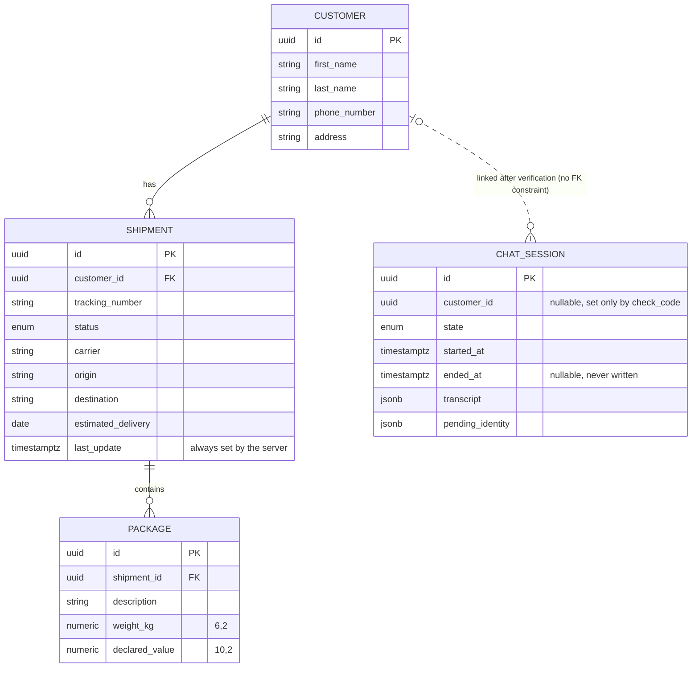

# Data Model (ERD)

As implemented (`backend/app/models/`). Tables are created by `Base.metadata.create_all` on startup; there are no migrations.

Table names are `customers`, `shipments`, `packages` and `chat_sessions`.

- **`shipments.status`**: `label_created`, `in_transit`, `out_for_delivery`, `delivered`, `exception`.
- **`chat_sessions.state`**: `anonymous`, `collecting_identity`, `code_sent`, `awaiting_code`, `verified`, `escalated_to_human` (the last one is never used; see `identity-gating-state-machine.md`).
- **`chat_sessions.customer_id`** is a plain nullable UUID column, not a database foreign key, which is why the link above is dashed. It stays empty until the code is verified.
- **`chat_sessions.transcript`** is a list of turns: `role` (`user`, `assistant` or `system`), `content`, `timestamp`, plus an optional `event` (`escalated_to_human` on the scripted handoff lines) and optional `tool_calls` (names of tools the model called on that turn).
- **`chat_sessions.pending_identity`** holds the unverified details the visitor typed (`first_name`, `last_name`, `address`, `phone_number`) while they are being collected.
- **Deletes** have no database cascade; the admin service removes packages, then shipments, then the customer.
- **Not in the database:** verification codes (in backend memory only) and admin users (they exist only in Auth0).
