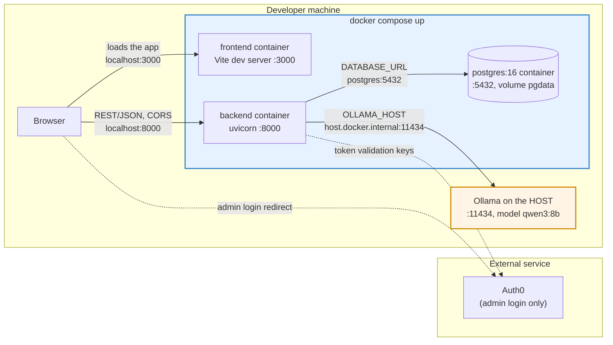

# Deployment / Local Dev Topology

As implemented (`docker-compose.yml`, `frontend/Dockerfile`, `backend/Dockerfile`, `frontend/src/main.tsx`, `backend/.env.example`, `frontend/.env.example`). Ollama runs on the host, not in Docker.

Notes:
- There is no proxy between the frontend and the backend. The browser gets the app from `:3000` and then calls the API on `:8000` directly (`axios.defaults.baseURL`); the backend's CORS allows only `http://localhost:3000`.
- The backend reads `AUTH0_DOMAIN` and `AUTH0_AUDIENCE` from `backend/.env` and will not start without them. The frontend reads `VITE_AUTH0_DOMAIN`, `VITE_AUTH0_CLIENT_ID` and `VITE_AUTH0_AUDIENCE` from `frontend/.env`.
- Native dev runs the same three processes on the same ports with only Postgres in Docker; the backend then reaches Ollama at `localhost:11434`. Don't run both setups at once.
- Verification codes are mock 2FA written to the backend log; no SMS provider is involved.
