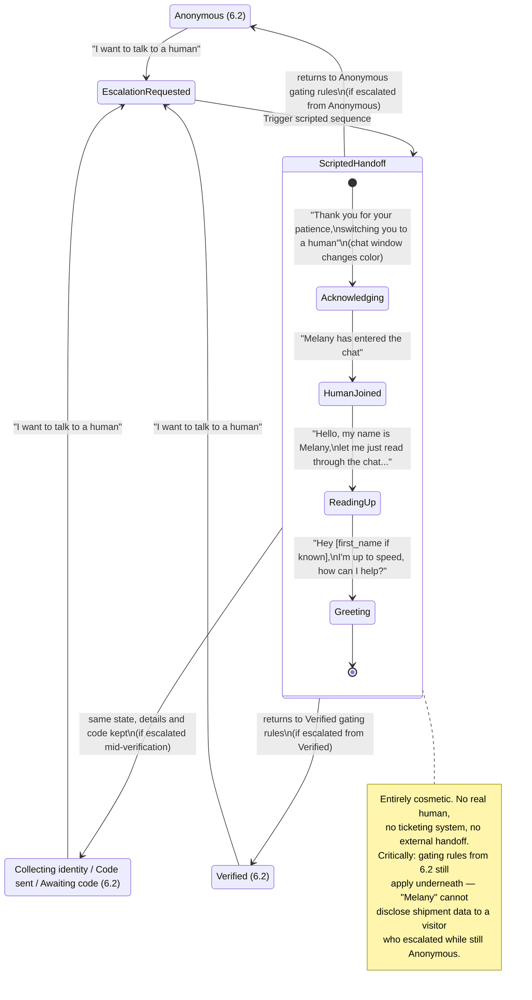

# Human Escalation Sequence (Epic G — cosmetic, scripted)

As implemented (`backend/app/services/escalation.py`, `backend/app/routes/chat.py`, `frontend/src/components/ChatWindow/useEscalationSequence.ts`):
- The trigger is a backend keyword match on the visitor's message (`is_asking_for_human`), not a decision by the model.
- Escalation can be requested from any 6.2 state, including mid identity collection and while a code is pending (G1 "at any point"). Collected details and any code in flight are kept.
- It never changes the session `state` or `customer_id`: the handoff lines are recorded in the transcript tagged `event: "escalated_to_human"`, so "returning" to the gating rules is automatic. The `escalated_to_human` state value is unused.
- The backend returns the script lines; the frontend shows the first line and shifts the window color at once, then plays the rest on a timer.
- The greeting uses only a first name the visitor typed in this chat; it is never looked up.
- Replies after the handoff are still model replies, with an extra prompt to speak as Melany, under the same gating rules.
- Asking again after escalating gets one line ("You're already chatting with Melany") instead of the full sequence.

