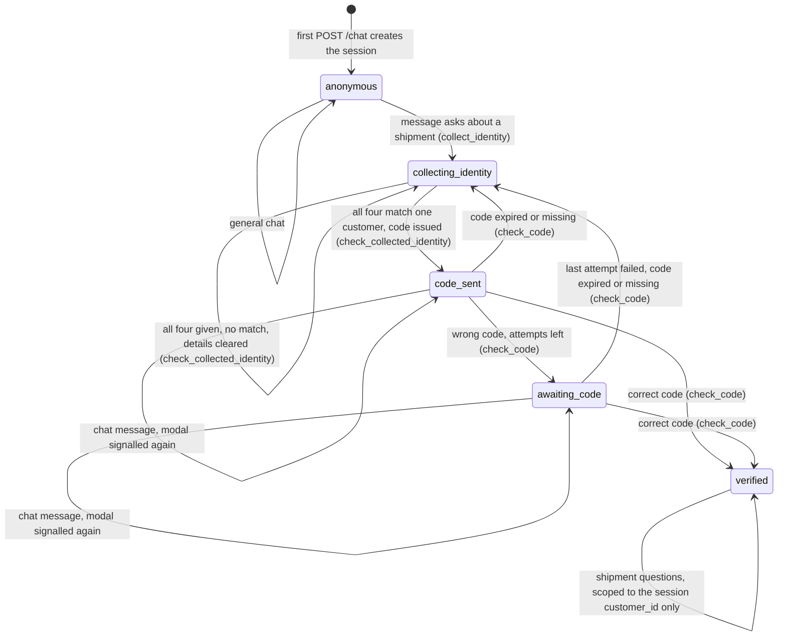

# Conversation / Identity-Gating State Machine

As implemented (`backend/app/models/chat_session.py`, `services/identity.py`, `services/verification.py`, `routes/chat.py`, `routes/verify.py`). The states are the values of `SessionState`; every transition is made by the backend function named on it, never by the model.

Notes:
- **Starting collection.** A separate structured-output model call (`extract_identity`) flags whether the message asks about a shipment and proposes details. The backend keeps a detail only if it visibly appears in the visitor's message.
- **No match.** The visitor sees the one neutral `IDENTITY_NOT_VERIFIED_MESSAGE`, the collected details are cleared and the session stays `collecting_identity`. Nothing moves a session back to `anonymous`.
- **Match.** The session moves to `code_sent` but `customer_id` is still empty. The matched customer id is held in memory next to the code until the code is verified.
- **Codes.** 6 digits, valid for 10 minutes, 3 attempts. Expiry is only noticed when a code is submitted; there is no background timer. Expiry, the last failed attempt and a missing code (for example after a backend restart) all give the same neutral `CODE_RESTART_MESSAGE` and clear the collected details.
- **`code_sent` vs `awaiting_code`.** Both show the code modal. `awaiting_code` only means at least one wrong code was entered.
- **`verified`.** `check_code` is the only place that sets `customer_id` and the only way into this state. There is no exit: sessions never time out or end (`ended_at` is never written).
- **`escalated_to_human`.** The value exists in `SessionState` but no session ever enters it. Asking for a human keeps the session in its current state; see `human-escalation-sequence.md`.
