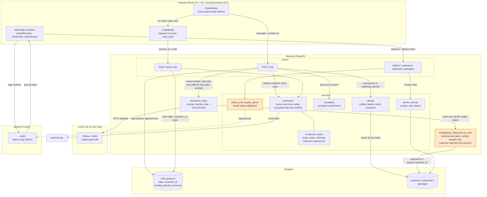

# System Architecture

As implemented (`backend/app/main.py`, `routes/`, `services/`, `tools/`, `llm/`, `frontend/src/App.tsx`, `frontend/src/main.tsx`):
- The chat and the admin area are two halves that share the database and nothing else: no shared code, state or login.
- There is no separate session store. A session's `state`, `customer_id`, collected details and transcript all live on its `chat_sessions` row in Postgres. The only in-memory piece is the verification-code dict in `services/verification.py`.
- The model never calls a tool to collect or check identity. The backend runs those steps itself; the model is only asked to extract details from text and to write replies.
- The mock SMS is a backend log line.
- The admin check is a router-level dependency (`require_admin`) on the `/admin` router, not app middleware.

The two highlighted boxes are the only access checks: `run_tool` for shipment data in the chat, `require_admin` for the admin API. `admin_records` never reads or writes `chat_sessions` (see `docs/admin-chat-separation.md`).
