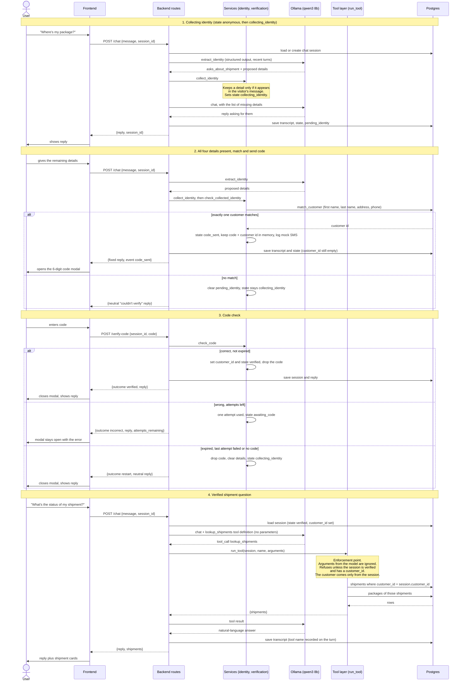

# Tool-Calling Sequence — HTTP (the gating enforcement point)

As implemented (`backend/app/routes/chat.py`, `routes/verify.py`, `services/identity.py`, `services/verification.py`, `llm/ollama_client.py`, `tools/lookup_shipments.py`). Plain HTTP request/response is the only transport in this build.

The model has exactly one tool, `lookup_shipments`, and only a verified session is offered it. Identity collection, matching and code checking are backend steps, not tools the model can call.

Notes:
- The tool definition has no parameters, so there is no customer argument for the model or the visitor to supply. `run_tool` re-checks the session on every call even though unverified sessions are never offered the tool.
- Every refusal (unverified session, unknown tool name) returns the same `TOOL_UNAVAILABLE_RESULT`, and no shipment data reaches the client for that turn.
- The model may go model → tool → model at most `MAX_TOOL_ROUNDS` (3) times per turn; after that the visitor gets a fixed "try again" reply.
- A message that asks for a human skips all of the above for that turn; see `human-escalation-sequence.md`.
